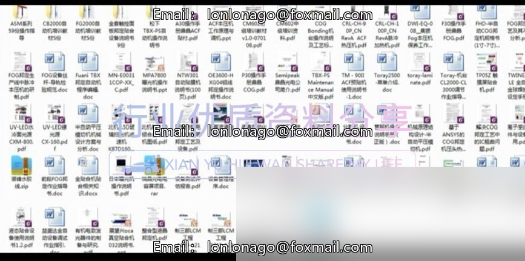
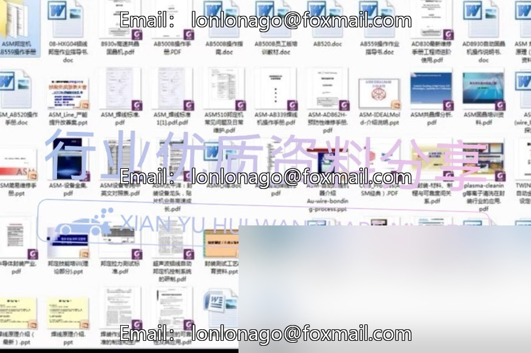

# A S M CO G bonding device technical data package, totaling more than 165+ files, including

## Body

ASM COG bonding equipment technical data package, totaling 165+ documents, including technical descriptions and equipment manuals, ASM crystal welding technology, which is extremely valuable for researching COG, COB, and TP! Low price!

Capture and send the electronic original directly! The following images include screenshots of the file portion. Please confirm before placing the order! Due to the replicable nature of electronic documentation Therefore, are allowed after purchase! Thanks for understanding!

For personal learning and reference use only.

A total of more than 165 files are provided, covering key bonding equipment technical materials, equipment manuals, ASM crystal soldering techniques, and electronic originals with screenshots for verification.

<!-- AI_ENRICHED -->

## Images

## Payment

Here is a pay link on Stripe ( https://buy.stripe.com/3cs8yP7sY87d0vu9AB ). Please contact me lonlonago@foxmail.com after funding $89, and I will send you a complete data files , thank you!

